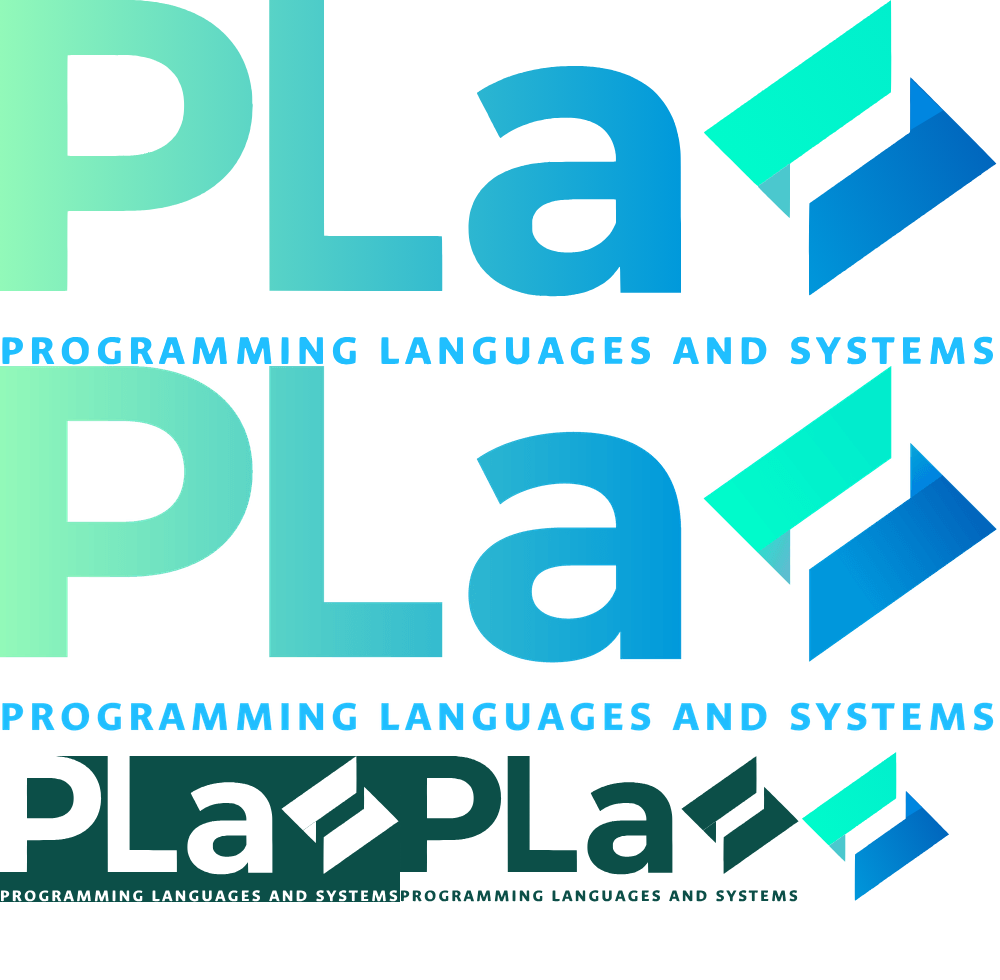
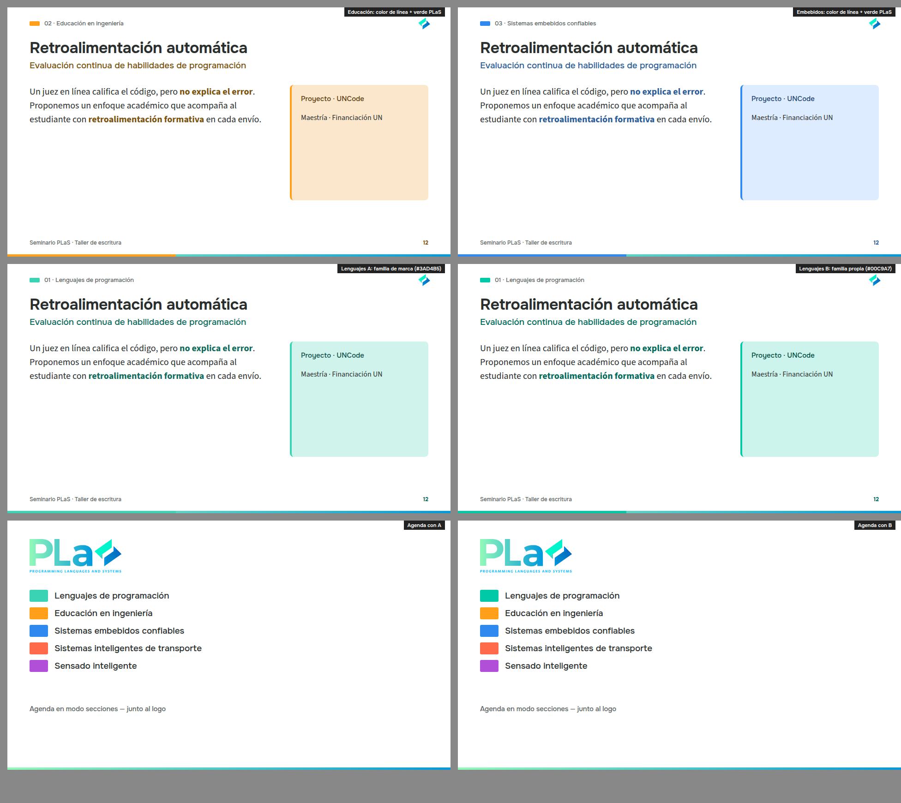

# Decisiones: color por línea, logo vectorial y publicación

**Fecha:** 2026-11-17
**Documentos previos:** [03-propuesta-tecnica.md](03-propuesta-tecnica.md), [04-identidad-visual-plas.md](04-identidad-visual-plas.md)

## 1. Resumen de decisiones

| # | Tema | Decisión |
|---|---|---|
| 1 | Logo vectorial | No existe un original. **Se redibujó en SVG** a partir del PNG del sitio (sección 2) |
| 2 | Tono | **Moderno y técnico, con calidez**, como el sitio web |
| 3 | Publicación | **Solo GitHub Pages** por ahora |
| 4 | Color en presentaciones de una línea | **Color principal de la línea, con presencia constante del verde PLaS** (sección 3) |
| 5 | Color de Lenguajes | **Color base `#00C9A7`** (el de `lines.json`), con los **tonos oscuros y suaves de la marca** (sección 4) |

## 2. Logo vectorial

### 2.1 Cómo se hizo

El logo se calcó por capas a partir de `web_plas/public/images/PLaS/Logo_PLaS.png`:

1. **Separación por color:**
   - letras "PLa";
   - chevrón menta;
   - chevrón azul;
   - pliegue verde azulado;
   - pliegue azul claro;
   - lema.
2. **Calco con potrace** de cada capa, ampliada a 4× para que los contornos queden suaves.
3. **Degradados de color** medidos sobre el original:
   - letras: `#92F9B9` → `#0099DB`, en horizontal;
   - chevrón menta: `#00FBCB` → `#01EFCD`;
   - chevrón azul: `#0097DB` → `#0166BD`.
4. **El pliegue azul claro** se trazó como un triángulo exacto, porque calcado salía con ruido.

### 2.2 Archivos (`brand/logo/`)

| Archivo | Uso |
|---|---|
| `plas-logo.svg` | Logo completo a color, con el lema |
| `plas-logo-compact.svg` | Logo a color sin el lema, para tamaños pequeños |
| `plas-logo-mono-dark.svg` | Una sola tinta (`#0C4F48`), sobre fondos claros |
| `plas-logo-mono-light.svg` | Una sola tinta (blanco), sobre fondos oscuros o de color |
| `plas-logo-currentcolor.svg` | Toma el color del texto que lo rodea, para insertarlo directamente en una página |
| `plas-symbol.svg` | Solo el símbolo de chevrones: marca de la diapositiva y posible ícono del sitio (favicon) |

### 2.3 Limitaciones

- Es un **calco**, no el archivo original: los bordes rectos de los chevrones pueden tener desviaciones mínimas, invisibles al tamaño de uso. Si aparece el original, se reemplaza sin afectar a nada más.
- El lema "PROGRAMMING LANGUAGES AND SYSTEMS" está calcado como formas, no como texto. Por debajo de unos 200 px de ancho del logo deja de leerse; para esos tamaños se usa `plas-logo-compact.svg`.

## 3. Color de línea con presencia constante del verde PLaS

Cada presentación de una línea usa el color de esa línea, pero el verde PLaS aparece siempre. La responsabilidad del color se reparte así:

| Elemento | Color | Razón |
|---|---|---|
| Marca de la miga de pan, bloques de sección, bordes de tarjetas y acentos de diagramas | **Color base de la línea** | Identifica la línea |
| Texto destacado, subtítulos y número de página | **Variante oscura de la línea** (`--mid-dark`) | Contraste suficiente (doc. 04, sección 4) |
| Fondos de tarjetas y llamadas | **Variante suave de la línea** (`--mid-soft`) | Jerarquía sin ruido |
| Símbolo de chevrones (arriba a la derecha, en todas las diapositivas) | **Verde PLaS** (colores del logo) | Firma de la marca |
| Franja inferior de 5 px | **Degradado PLaS** (`#92F9B9` → `#0099DB`) | Firma de la marca |
| Logo en la portada, la agenda y el cierre | **Verde PLaS** | Firma de la marca |

**Hallazgo de la maqueta:** la barra de progreso de la línea, dibujada sobre la franja con el degradado PLaS, apenas se distingue en Lenguajes, porque los dos verdes son casi iguales. **Decisión para la prueba de concepto:** la franja inferior queda solo como firma de la marca, y el progreso se muestra junto a la miga de pan, en el color de la línea.

## 4. Color de Lenguajes

Se compararon dos opciones en la maqueta:

- **A:** usar la familia de marca completa, con base `#3AD4B5`, como hace hoy el sitio.
- **B:** usar `#00C9A7`, el color de la línea en `lines.json`.

En las diapositivas de contenido son casi indistinguibles. En la agenda, que pone las cinco líneas una al lado de la otra, la diferencia sí se nota:

- `#3AD4B5` (A) se ve **más pálido** que las otras cuatro líneas, que son colores saturados.
- `#00C9A7` (B) tiene la **misma intensidad** que el resto y se distingue mejor de la franja con el degradado de marca.

**Decisión:** Lenguajes usa la **opción B** como color base, y comparte con la marca los tonos derivados, porque son prácticamente los mismos. Esos tonos son la base de la Tabla 3, la de los demás tonos de cada línea:

| Token | Lenguajes |
|---|---|
| `--base` | `#00C9A7` |
| `--mid-soft` | `#D0F3EC` (de la marca) |
| `--mid-dark` | `#0E6B5C` (de la marca) |
| `--deep` | `#0C4F48` (de la marca) |

Lenguajes queda así como **la línea madre**: es la que más se parece a la marca, pero su color base sigue alineado con las otras líneas y con los grafos de temas del sitio, que ya usan `#00C9A7`.

## 5. Tabla final de tokens de color para las presentaciones

| Línea | `--base` | `--mid-soft` | `--mid-dark` | `--deep` |
|---|---|---|---|---|
| Lenguajes de programación | `#00C9A7` | `#D0F3EC` | `#0E6B5C` | `#0C4F48` |
| Educación en ingeniería | `#FF9F1A` | `#FBE7CC` | `#7A530E` | `#5A3E0F` |
| Sistemas embebidos confiables | `#2F89EF` | `#DDECFE` | `#2C5D98` | `#224570` |
| Sistemas inteligentes de transporte | `#FF6B4A` | `#FEE3DD` | `#923F2C` | `#6C2F22` |
| Sensado inteligente | `#B14FD8` | `#F6E2FF` | `#77418E` | `#583169` |
| *Marca (presentaciones sin línea)* | `#3AD4B5` | `#D0F3EC` | `#0E6B5C` | `#0C4F48` |

En **modo secciones** se usan los colores `--base` en el orden de la tabla.

## 6. Pendientes que quedan abiertos

| # | Pendiente | Cuándo |
|---|---|---|
| 1 | Fuente monoespaciada: Source Code Pro o JetBrains Mono | Prueba de concepto |
| 2 | Tema de resaltado de sintaxis derivado de la paleta | Prueba de concepto |
| 3 | Usar `plas-symbol.svg` como ícono del sitio en `web_plas` | Fuera del alcance del formato; se sugiere al equipo del sitio |
