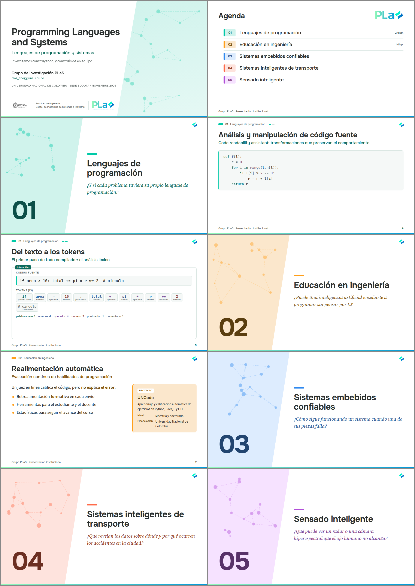
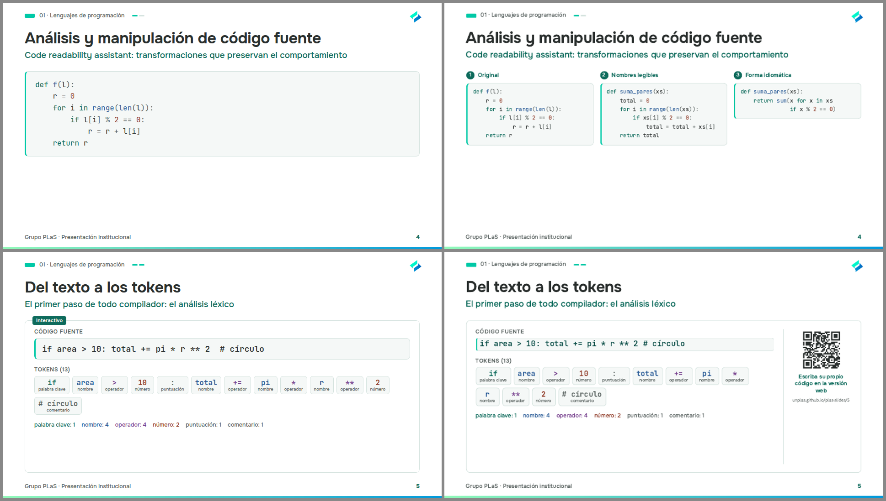
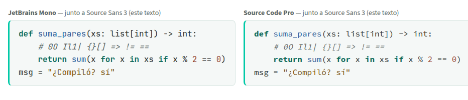

# Resultados de la prueba de concepto

**Fecha:** 2026-11-17
**Documentos previos:** [03-propuesta-tecnica.md](03-propuesta-tecnica.md) (alcance y criterios, sección 10), [05-decisiones-color-logo-publicacion.md](05-decisiones-color-logo-publicacion.md)

## 1. Resumen

La prueba de concepto **cumple tres de los cuatro criterios de éxito**. El cuarto, que un agente escriba una diapositiva solo con `AGENTS.md`, tiene todo listo para ejecutarse, pero aún no se ha probado.

- La misma fuente produce la web y el PDF, que coinciden visualmente.
- Cada animación y cada herramienta tiene su versión impresa.
- Las fuentes viajan dentro del tema y del PDF.
- El validador detecta errores reales en las dos salidas.

## 2. Qué se construyó

| Pieza | Ubicación | Contenido |
|---|---|---|
| Tema | `theme/` | `slidev-theme-plas` 0.1.0, sobre Slidev 53.1.0 |
| Tokens | `theme/styles/tokens.css` | Paleta de marca, 5 familias de línea, tipografía y espaciado |
| Maquetas | `theme/layouts/` | `cover`, `agenda`, `section`, `default`, `code`, `interactive` (6 de las 14 del catálogo) |
| Componentes | `theme/components/` | Cabecera y pie, fila de logos, malla de grafos, `WebOnly`/`PrintOnly`, `Frames`, `Interactive`, `QrCode`, `ProjectCard` |
| Tema de sintaxis | `theme/setup/shiki.ts` | "PLaS Claro": cada categoría de código usa el tono oscuro de una línea |
| Validador | `theme/bin/plas-check.mjs` | Comando `plas-check`: 12 reglas estáticas y 4 de renderizado |
| Presentación de prueba | `poc/` | 10 diapositivas basadas en `PLaS_intro.pdf` y en datos del sitio web |
| Plantilla | `template/` | Punto de partida con `AGENTS.md` (reglas para agentes) |
| Prueba del validador | `tools/check/fixtures/malo/` | Presentación con 8 tipos de error intencionados |

### Comportamiento del sistema

- **Color automático:** cada separador declara su `line`, y las diapositivas siguientes heredan el color. La agenda, la miga de pan y la barra de progreso de la sección se **generan solas** a partir de los separadores.
- **Firma PLaS constante:** el símbolo de chevrones (que también es el botón para volver a la agenda), la franja con el degradado y el logo en la portada y la agenda.
- **Contraste garantizado por el tema:** el texto en negrita usa siempre el tono oscuro de la línea. Las insignias usan el tono suave con texto oscuro, o el tono oscuro con texto blanco.

## 3. Evaluación de los criterios de éxito

| # | Criterio (doc. 03 §10) | Resultado | Evidencia |
|---|---|---|---|
| 1 | El PDF coincide visualmente con la web | **Cumplido** | Comparación página por página (figura siguiente). El PDF mide 720 × 405 pt, que equivale al lienzo de 960 × 540 px |
| 2 | Cada animación tiene una versión impresa legible | **Cumplido** | Magic Move → tira de 3 fotogramas (`<Frames>`). Analizador léxico → instantánea con QR. Malla de grafos → estática |
| 3 | Las fuentes se ven igual sin instalar nada | **Cumplido** | El PDF incrusta solo Onest, Source Sans 3, Source Serif 4 y JetBrains Mono. La web las sirve desde su propio paquete, sin pedir nada a Google |
| 4 | Un agente, solo con `AGENTS.md`, escribe una diapositiva que pasa el validador | **Pendiente** | La guía y el validador están listos; falta ejecutar la prueba con un agente sin contexto previo |

### Validador

| Prueba | Resultado |
|---|---|
| `poc/slides.md` con renderizado | 10 diapositivas · 0 errores · 0 avisos |
| `fixtures/malo/slides.md` (errores intencionados) | 16 errores y 1 aviso; detecta los 8 tipos sembrados |

Reglas verificadas contra errores reales:

- **Estáticas:** separador sin línea, título largo, más de 6 viñetas, animación sin versión impresa, `<Interactive>` sin `#print`, colores escritos a mano, texto justificado y maqueta inexistente.
- **De renderizado** (en la web y en el PDF): título en dos líneas, elemento fuera de la diapositiva, contenido que invade el pie y diapositiva que no carga con el tema.

Cada mensaje indica la diapositiva, la línea del archivo, la regla y la corrección (`→ …`), y con `--json` sale en un formato que un agente puede leer directamente.

## 4. Problemas encontrados durante la prueba y cómo se resolvieron

Cada problema se convirtió en una regla del sistema, para que no se repita:

| Problema | Causa | Solución | Nivel de la regla |
|---|---|---|---|
| El nombre del ponente no aparecía en la portada | `author` es una clave reservada de Slidev | Se usa `speaker` | Tema y `AGENTS.md` |
| El código impreso salía en LiberationMono | La regla `code { font-mono }` de Slidev tenía prioridad | Se fuerza la fuente en `pre code` y se declaran las fuentes en la configuración del tema | Tema |
| Aparecían recuadros alrededor de cada línea de código | La regla del borde también afectaba al `<code>` interior | Se separaron las reglas de fuente y de borde | Tema |
| Los números de los fotogramas eran invisibles | La regla de énfasis (`b` en tono oscuro) coincidía con el fondo | Se usa un elemento sin significado de énfasis | Tema |
| Texto blanco sobre el color base (contraste de 2:1) | Se olvidó la regla de contraste del doc. 04 | Insignias con tono suave y texto oscuro, o tono oscuro y texto blanco | Tema |
| Los nodos de la malla tapaban el número del separador | La malla ocupaba todo el panel | La malla se limita a la parte superior | Tema |
| Una exportación borraba la anterior | El PDF se guardaba en la carpeta de la compilación | El PDF va a `export/` | Plantilla |

## 5. Decisiones tomadas en la prueba

| Decisión | Razón |
|---|---|
| **Fuente de código: JetBrains Mono** | Tiene mayor altura de minúscula, así que se lee mejor proyectada; distingue `0/O` e `Il1`; su aire geométrico combina con Onest. Source Code Pro se ve más liviana a distancia. Se puede cambiar con `themeConfig.mono: source-code-pro` |
| **Tema de sintaxis con los colores de las líneas** | El código lleva la paleta del grupo; todos los colores cumplen un contraste ≥ 4,5:1 sobre el fondo del código |
| **Progreso junto a la miga de pan** | Evita el choque con la franja de marca (doc. 05 §3) |
| **El validador viaja con el tema** (`plas-check`) | Cada presentación, en su propio repositorio, se valida sin copiar herramientas |
| **Navegador del validador** | Usa `PLAS_CHROME`, o el Chrome del sistema, o el Chromium de Playwright |

## 6. Limitaciones conocidas

1. **El código animado se escribe dos veces:** una para Magic Move y otra para `<Frames>`. El validador garantiza que existan las dos versiones, pero no que coincidan. *Mejora:* un componente que genere ambas a partir de un solo bloque.
2. **Faltan 8 maquetas del catálogo** (doc. 03 §6): `cover-brand`, `two-cols`, `diagram`, `math`, `project` (hoy cubierta en parte por `<ProjectCard>`), `quote`, `team` y `closing`.
3. **Las listas de maquetas y líneas están duplicadas** en `usePlas.ts` y en `plas-check.mjs`. *Mejora:* un único archivo de configuración compartido.
4. **No hay forma de instalar el tema desde fuera.** `slidev-theme-plas` solo existe en este repositorio. Hay que decidir cómo se instala en los repositorios de cada presentación (paquete en GitHub Packages, dependencia de Git o publicación en npm). *Resuelto en el doc. [10](10-donde-viven-las-presentaciones.md): las presentaciones se escriben dentro del clon y no hace falta instalar el tema por separado.*
5. **No se ha probado `v-click` en el PDF.** Slidev muestra el estado final, pero no se ha comprobado con contenido real.
6. **No hay despliegue automático a GitHub Pages:** falta el flujo de trabajo de CI (compilar, validar, exportar el PDF y publicar los dos).
7. Slidev 53.1.0 se publicó el 5 de noviembre de 2026; conviene fijar la versión y actualizarla con la presentación de prueba como prueba de regresión.

## 7. Próximos pasos propuestos

1. **Ejecutar el criterio 4:** pedir a un agente sin contexto que escriba 2 o 3 diapositivas nuevas usando solo `template/AGENTS.md`, y ajustar la guía según los fallos.
2. **Completar el catálogo de maquetas**, empezando por `closing`, `team` y `two-cols`, que son las más usadas en `PLaS_intro`.
3. ~~Definir cómo se distribuye el tema~~ (doc. 10) y crear el flujo de CI para GitHub Pages.
4. **Migrar las dos presentaciones reales** (`PLaS_intro` y el taller de escritura) como validación final, según el paso 4 del doc. 01 §7.
