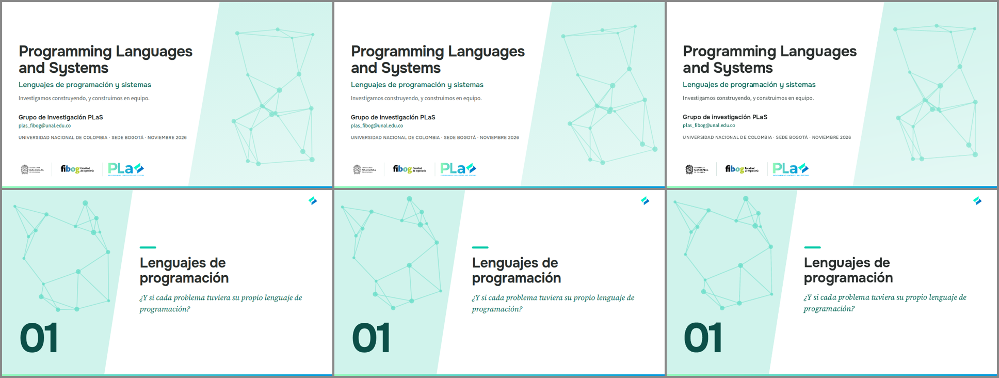
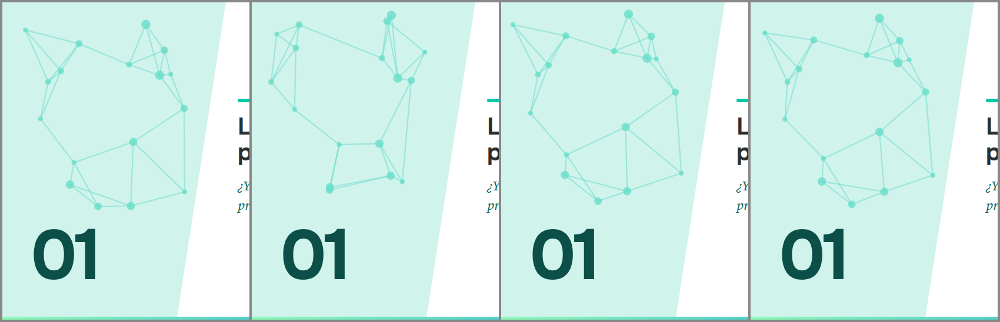

# Malla de grafos: flotar, rotar y ajustarse

**Fecha:** 2026-11-17
**Documentos previos:** [04-identidad-visual-plas.md](04-identidad-visual-plas.md) (malla del sitio), [06-resultados-prueba-de-concepto.md](06-resultados-prueba-de-concepto.md)

## 1. Decisión

La malla de grafos de la portada y de los separadores **flota, rota y se ajusta** a su panel, con el mismo motor que el sitio web.

| Pregunta | Decisión |
|---|---|
| Rotación | **Oscilante**: ±7° de ida y vuelta en 40 s. Una rotación continua es demasiado larga para una presentación |
| ¿Reacciona a la presentación (clics, cambio de diapositiva)? | **No**: es autónoma |

## 2. Comportamiento

| Mecanismo | Valor | Origen |
|---|---|---|
| Deriva por nodo | 0,022–0,055 px por cuadro, en dirección aleatoria fija | Sitio (`network-mesh.ts`) |
| Variantes de la red | 3 disposiciones: la primera libre, las otras dos derivadas de ella con variaciones del 8 % | Sitio |
| Aristas | Hasta 3 vecinos cercanos por nodo; solo se conservan las que siguen siendo cercanas en las 3 variantes | Sitio |
| Cambio de variante | Cada 20 s los nodos **se deslizan** a una variante en 3,2 s, con aceleración y frenado suaves (cambia de variante cada 2 reinicios) | Sitio: allí se desvanece y reaparece al alejarse 140 px. Aquí es por tiempo y por deslizamiento, para que no sea instantáneo |
| Flotación del grupo | Trayectoria de Lissajous de ±14 px (periodos de 23 s y 31 s) | Diapositivas: la malla es autónoma, no sigue al puntero |
| Rotación del grupo | Oscilante, ±7° en 40 s, alrededor del centro del panel | Diapositivas |
| Ajuste | En cada cuadro, después de rotar y flotar: los bordes del panel actúan como paredes (el nodo rebota) y las zonas reservadas lo repelen | Diapositivas |
| Aristas elásticas | Se desvanecen si sus nodos se separan más de 1,3 veces la distancia de unión | Diapositivas |
| Nodos sueltos | Se eliminan al construir la red | Diapositivas |
| Escala ("zoom") | Unos 0,95 nodos por cada 10 000 px² de panel (18 a 20 nodos); la distancia de unión se ajusta a esa separación | Diapositivas: más grande y menos denso que en el sitio |
| Estilo | Aristas sólidas de 2,2 px y nodos de 3,5 a 8 px de radio, variados como en la primera versión | Diapositivas |

**Cuándo se anima:** solo en la diapositiva activa, en la vista normal o en la del presentador. En el PDF, en la vista general, en la vista previa del presentador y con `prefers-reduced-motion`, se muestra el estado inicial, sin movimiento.

## 3. Paridad web ⇄ PDF

El estado inicial de la web y el del PDF son el mismo: la primera variante, sin rotación ni desplazamiento. La animación no agrega contenido; solo mueve la composición.

## 4. Verificación

Se tomaron muestras de la posición de cada nodo cada 0,5 s durante 24 s, cubriendo un cambio de variante:

| Diapositiva | Nodos | Muestras | Fuera del panel | Dentro de zona reservada | Desplazamiento máximo |
|---|---|---|---|---|---|
| Portada | 19 | 912 | 0 | 0 | 94 px |
| Separador 01 | 17 | 816 | 0 | 0 (número de sección) | 75 px |

El salto máximo de un nodo entre dos muestras seguidas es de 25 px cada 0,5 s, también durante el cambio de variante, así que el movimiento es continuo.

El validador (`plas-check --render`) pasa con 0 errores, y el PDF exportado muestra el estado inicial.

## 5. Implementación

| Archivo | Contenido |
|---|---|
| `theme/composables/meshEngine.ts` | Lógica pura: generación con semilla fija, variantes, aristas, ajuste a regiones convexas y transformación del grupo |
| `theme/components/NetworkMesh.vue` | Dibujo SVG, bucle de animación y control de cuándo se anima |
| `theme/layouts/cover.vue`, `section.vue` | Región = polígono del panel; zona reservada = número de la sección |

**Uso:** `<NetworkMesh :region="PANEL" :avoid="[ZONA]" :seed="n" />`. La región debe ser un polígono **convexo** en coordenadas de la diapositiva (960 × 540).

**Pendiente:** el motor está copiado del sitio web. Si cambia el del sitio, conviene extraer la lógica común a un módulo compartido por los dos repositorios.
