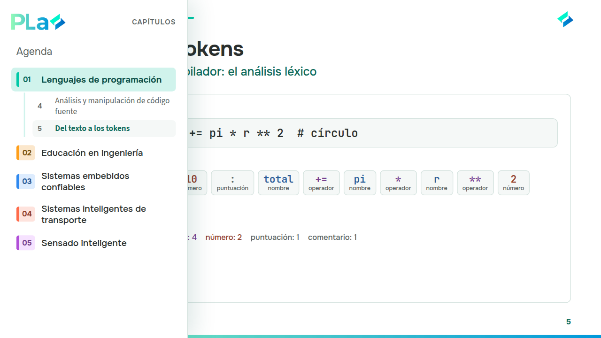

# Panel lateral de capítulos

**Fecha:** 2026-11-17
**Documentos previos:** [03-propuesta-tecnica.md](03-propuesta-tecnica.md) (§7, aire de LMS)

## 1. Qué hace

En la versión web, al llevar el mouse al **borde izquierdo** de la diapositiva, o al pulsar **C**, se abre un panel con los capítulos de la presentación, para saltar rápidamente entre ellos.

| Elemento | Comportamiento |
|---|---|
| Apertura | Al entrar con el mouse en una franja invisible de 14 px junto al borde izquierdo, o con la tecla **C** |
| Cierre | Al salir del panel, al elegir un destino, con **C** o con **Esc** |
| Atajo C | No responde con Ctrl, Alt o Cmd, ni mientras se escribe en un campo (por ejemplo, el analizador léxico). No choca con los atajos de Slidev (`d`, `o`, `` ` ``, `g`, `f`, Esc, flechas, espacio) |
| Agenda | Enlace fijo en la parte superior |
| Capítulos | Uno por cada diapositiva `layout: section`, con su número y el color de su línea (o el de la presentación en modo línea) |
| Capítulo actual | Resaltado y desplegado con los títulos de sus diapositivas; la diapositiva actual se marca |
| PDF | No se dibuja (capa solo para la web) |

Los capítulos salen de la misma función que alimenta la agenda y la miga de pan (`buildSections` en `theme/composables/usePlas.ts`), así que el autor no escribe nada adicional.

## 2. Implementación

| Archivo | Contenido |
|---|---|
| `theme/global-top.vue` | Capa global del tema; dibuja el panel salvo en el PDF |
| `theme/components/ChapterPanel.vue` | Panel, franja de apertura y navegación (`useNav().go`) |
| `theme/composables/usePlas.ts` | `buildSections`, `agendaNoOf` y `slideTitle`, compartidas con las maquetas |

## 3. Verificación

Prueba automatizada con Playwright (ventana de 1280 × 720):

| Paso | Resultado |
|---|---|
| Al cargar | Cerrado |
| Mouse al borde izquierdo | Abierto |
| Clic en "Educación en ingeniería" | Navega a la diapositiva 6 y se cierra |
| Mouse fuera del panel | Cerrado |
| Texto "Capítulos" en el PDF exportado | 0 apariciones |
| C | Abre; C otra vez, cierra |
| C y luego Esc | Cerrado |
| Ctrl+C | No lo abre |
| Escribir "c" en el campo del analizador léxico | No lo abre; la letra llega al campo |

`plas-check --render`: 0 errores.
