# Guía de formato de presentaciones PLaS

**Versión del tema:** `slidev-theme-plas` 0.1.0 · **Fecha:** 2026-11-17
**Para quién:** estudiantes y profesores del grupo que preparan presentaciones, solos o con ayuda de agentes de IA.
**Relación con otros documentos:** esta es la referencia visual del formato. Las mismas reglas, escritas para agentes, están en [`template/AGENTS.md`](../template/AGENTS.md). Las decisiones que las justifican están en los documentos 01 a 08.

Todas las imágenes salen de la presentación de muestra [`showcase/slides.md`](../showcase/slides.md), que usa cada maqueta y cada elemento de contenido. Para verla en movimiento: `npm run dev -w showcase`.

---

## 1. Principios

1. **Una fuente, dos salidas.** Cada presentación se escribe una vez en `slides.md` y produce una versión web (con animaciones e interacción) y un PDF. **La web es el PDF que además se mueve:** nada existe solo en la web.
2. **El color dice dónde estamos.** Cada línea de investigación tiene su color, y las diapositivas lo heredan de su sección.
3. **La firma PLaS está siempre presente:** el símbolo de chevrones, la franja con el degradado de marca y el logo en la portada y la agenda.
4. **Poca decoración.** Sin cajas ni bordes en la cabecera y el pie; el espacio es para el contenido.
5. **Todo se valida.** Una presentación está terminada cuando `npm run check` termina sin errores.

---

## 2. Fundamentos

### 2.1 Lienzo y zonas

| Elemento | Valor |
|---|---|
| Lienzo | 960 × 540 px (16:9); el PDF mide 720 × 405 pt |
| Margen lateral | 48 px |
| Cabecera | Miga de pan arriba a la izquierda (y = 22 px) y símbolo PLaS arriba a la derecha |
| Zona de contenido | De y = 68 a y = 488 px. Título y subtítulo arriba; **el cuerpo se centra verticalmente** en el espacio restante (el código animado se ancla arriba para no saltar entre pasos) |
| Pie | Nombre del evento a la izquierda y número de página a la derecha (y = 520 px) |
| Firma | Franja de 5 px con el degradado PLaS en el borde inferior |

### 2.2 Tipografía

Todas las fuentes son libres y van dentro del tema: se ven igual en cualquier equipo y quedan incrustadas en el PDF.

| Rol | Fuente | Tamaño | Peso |
|---|---|---|---|
| Título de diapositiva (`#`) | Onest | 34 px | 650 |
| Título de portada | Onest | 52 px | 650 |
| Título de separador | Onest | 40 px | 650 |
| Subtítulo (`##`) | Onest | 19 px, a 10 px del título | 500, tono oscuro de la línea |
| Cuerpo | Source Sans 3 | 20 px, interlineado 1,5 | 400 |
| Citas y preguntas de sección | Source Serif 4 | 22 px | Cursiva |
| Código | JetBrains Mono | 15 px (16 px en la maqueta `code`) | 400; palabras clave en 700 |
| Cabecera y pie | Onest | 12,5 px | 500 |
| Ecuaciones | KaTeX | Según el cuerpo | — |

### 2.3 Color

Cada línea de investigación tiene una familia de cuatro tonos:

| Línea | Base | Suave | Oscuro | Profundo |
|---|---|---|---|---|
| Lenguajes de programación | `#00C9A7` | `#D0F3EC` | `#0E6B5C` | `#0C4F48` |
| Educación en ingeniería | `#FF9F1A` | `#FBE7CC` | `#7A530E` | `#5A3E0F` |
| Sistemas embebidos confiables | `#2F89EF` | `#DDECFE` | `#2C5D98` | `#224570` |
| Sistemas inteligentes de transporte | `#FF6B4A` | `#FEE3DD` | `#923F2C` | `#6C2F22` |
| Sensado inteligente | `#B14FD8` | `#F6E2FF` | `#77418E` | `#583169` |
| *Marca (sin línea)* | `#3AD4B5` | `#D0F3EC` | `#0E6B5C` | `#0C4F48` |

**Uso de cada tono:**

| Tono | Dónde se usa | Dónde no |
|---|---|---|
| Base | Marcas, viñetas, bordes, barras, malla de grafos | **Nunca en texto**: su contraste sobre blanco es de 2:1 a 4,2:1 |
| Suave | Fondos de paneles, tarjetas y código en línea | — |
| Oscuro | Subtítulos, negritas, números de página y de lista | — |
| Profundo | Número grande del separador, títulos de tarjetas | — |

**Dos modos:**

- **Modo secciones** (por defecto): cada separador declara su `line` y las diapositivas siguientes heredan ese color. Sirve para presentaciones que recorren varias líneas, como la institucional.
- **Modo línea:** `themeConfig.line` en el encabezado aplica una sola línea a toda la presentación. Sirve para sustentaciones o avances de una línea.

Los colores de texto, fondo y bordes los aplica el tema. **El autor nunca escribe colores.**

### 2.4 Navegación

| Elemento | Qué hace | Versión impresa |
|---|---|---|
| Miga de pan | Marca de color, número y nombre de la sección actual | Igual |
| Progreso de la sección | Segmentos junto a la miga de pan: avance dentro del capítulo | Igual |
| Símbolo PLaS (arriba a la derecha) | Vuelve a la agenda | Igual (sin enlace) |
| Pie | Nombre del evento y número de página | Igual |
| Panel de capítulos | Se abre llevando el mouse al borde izquierdo o con **C**; salta a cualquier capítulo o diapositiva | No aparece |

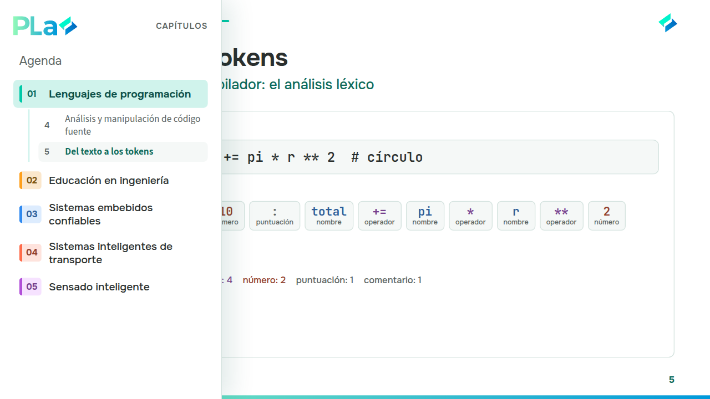

La agenda, la miga de pan y el panel se generan solos a partir de los separadores. **El título de cada separador es el nombre del capítulo en todos esos lugares**, así que conviene que sea corto y claro.

---

## 3. Tipos de diapositiva

### 3.1 Portada — `cover`

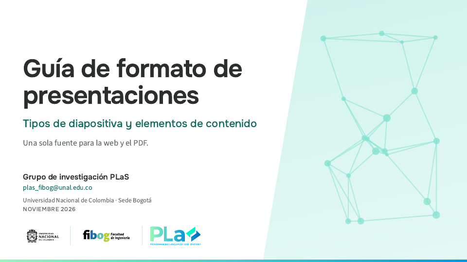

**Cuándo:** solo en la primera diapositiva.

**Jerarquía:** el título es el protagonista. Título, subtítulo y párrafo forman un bloque (componente `TitleBlock`) centrado verticalmente en la diapositiva; si el bloque crece, sube solo sin invadir la firma. Si el título pasa de 3 líneas, `plas-check` avisa. La firma (expositor, correo, lugar y fecha) baja hasta quedar sobre los logos, en tamaños menores: nombre a 16 px, correo a 14 px y lugar a 13 px en gris. El lugar debe caber en una línea: omita lo que ya dicen los logos (universidad, facultad). Si no cabe, `plas-check` avisa.

**Estructura:**

```md
---
theme: plas
title: Guía de formato PLaS
layout: cover
speaker: Grupo de investigación PLaS      # quien presenta (no use `author`)
email: plas_fibog@unal.edu.co
place: Universidad Nacional de Colombia · Sede Bogotá
date: Noviembre 2026
themeConfig:
  event: Guía de formato de presentaciones  # texto del pie en todas las diapositivas
  webUrl: https://unplas.github.io/<repositorio>
---

# Guía de formato de presentaciones

## Tipos de diapositiva y elementos de contenido

Una sola fuente para la web y el PDF.
```

**Composición:** texto a la izquierda; panel de color a la derecha con la malla de grafos (en la web flota, rota y se ajusta al panel); fila de logos **UNAL │ Facultad de Ingeniería │ PLaS** abajo a la izquierda.

**Reglas:**

- El título puede ocupar dos líneas; el subtítulo, una.
- Un párrafo corto como máximo, por ejemplo el lema o una frase de contexto.
- Los datos del ponente van en el frontmatter, no en el cuerpo.

### 3.2 Índice — `agenda`

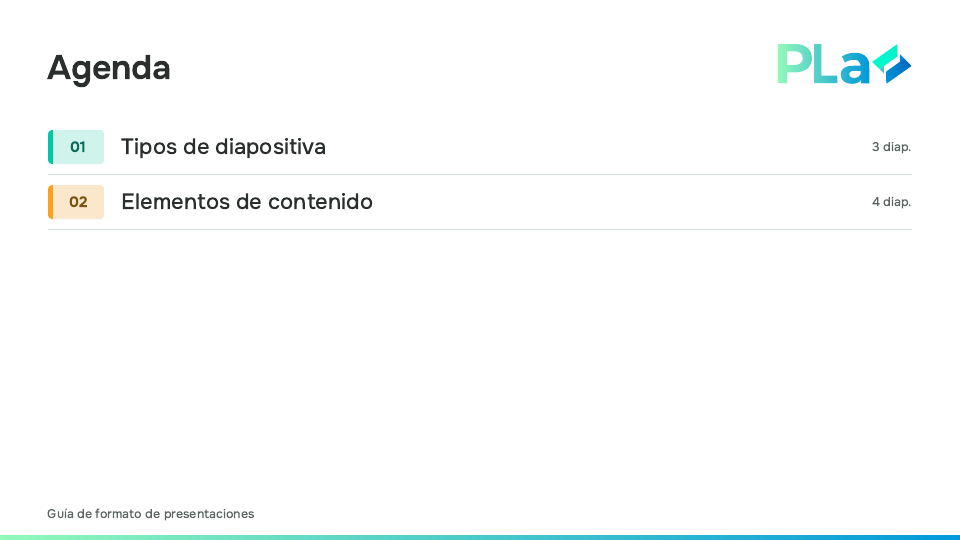

**Cuándo:** la segunda diapositiva, si la presentación tiene dos o más capítulos.

```md
---
layout: agenda
---

# Agenda
```

**Composición:** la lista **se genera sola** a partir de los separadores, con el número, el color de la línea, el título y la cantidad de diapositivas de cada capítulo. En la web, cada fila lleva a su capítulo.

**Regla:** no escriba la lista a mano.

### 3.3 Separador de sección — `section`

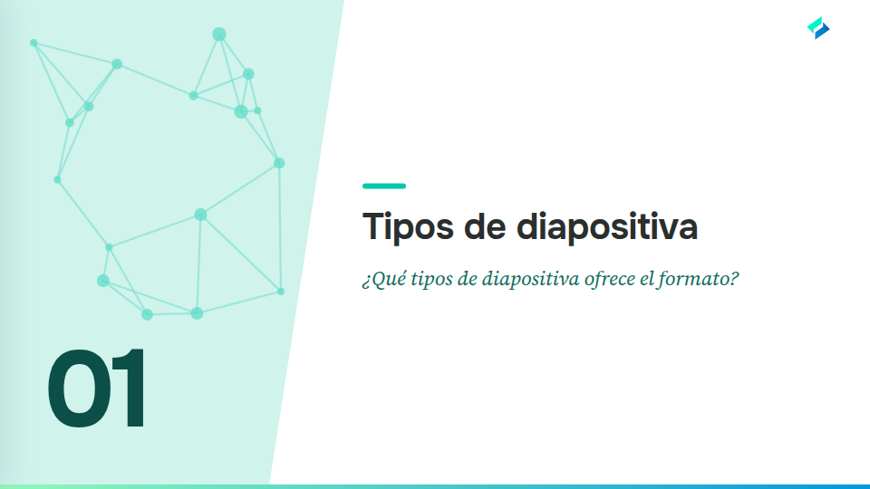
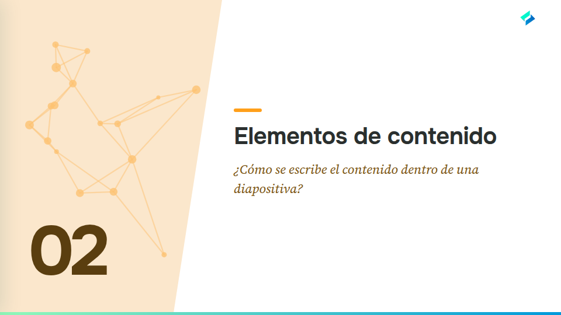

**Cuándo:** al comienzo de cada capítulo.

```md
---
layout: section
line: educacion
question: ¿Cómo se escribe el contenido dentro de una diapositiva?
---

# Elementos de contenido
```

**Composición:** panel de color a la izquierda con la malla de grafos y el número grande del capítulo; a la derecha, barra de acento, título y pregunta en cursiva.

**Reglas:**

- `line` es obligatorio en modo secciones; los valores válidos son `lenguajes`, `educacion`, `embebidos`, `transporte` y `sensado`, más `plas` (colores de la marca) para secciones que no son de ninguna línea, como «Cómo unirse» o el cierre.
- Título de 40 caracteres como máximo. El detalle va en `question`.
- La pregunta abre el capítulo; las de cada línea están en `web_plas/src/data/lines.json`.

### 3.4 Contenido general — `default`

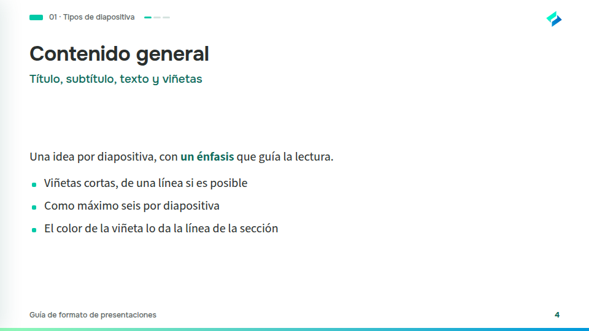

**Cuándo:** la mayoría de las diapositivas: una idea con texto y viñetas.

```md
---
layout: default
---

# Contenido general

## Título, subtítulo, texto y viñetas

Una idea por diapositiva, con **un énfasis** que guía la lectura.

- Viñetas cortas, de una línea si es posible
- Como máximo seis por diapositiva
```

**Reglas:**

- Título obligatorio, de una línea y 50 caracteres como máximo.
- Subtítulo opcional, de una línea y 90 caracteres como máximo.
- Unas 110 palabras como máximo en la diapositiva; el detalle va en las notas del presentador.

### 3.5 Contenido con columna lateral — `default` + `::aside::`

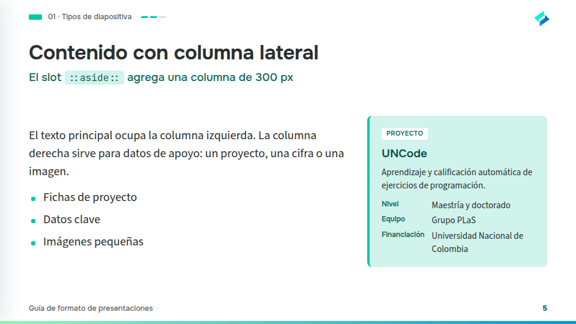

**Cuándo:** el texto necesita un dato de apoyo al lado: una ficha de proyecto, una cifra o una imagen pequeña.

```md
---
layout: default
---

# Contenido con columna lateral

Texto principal…

::aside::

<ProjectCard title="UNCode" level="Maestría y doctorado" funding="Universidad Nacional de Colombia">

Aprendizaje y calificación automática de ejercicios de programación.

</ProjectCard>
```

**Composición:** columna principal flexible y columna derecha de 300 px, separadas por 36 px. El título y el subtítulo ocupan todo el ancho.

### 3.6 Código — `code`

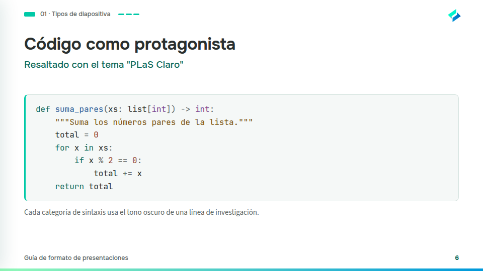

**Cuándo:** el código es el contenido principal.

````md
---
layout: code
---

# Código como protagonista

## Resaltado con el tema "PLaS Claro"

```python
def suma_pares(xs: list[int]) -> int:
    ...
```

Cada categoría de sintaxis usa el tono oscuro de una línea de investigación.
````

**Tema de sintaxis "PLaS Claro":** palabras clave en verde azulado oscuro (Lenguajes), cadenas en ocre (Educación), funciones en azul (Embebidos), números en terracota (Transporte), tipos en violeta (Sensado) y comentarios en gris cursiva. Todos con contraste de 4,5:1 o más sobre el fondo del código.

**Código animado:** para mostrar una transformación paso a paso se usa Magic Move dentro de `<WebOnly>`, y su versión impresa con `<Frames>` dentro de `<PrintOnly>`:

`````md
<WebOnly>

````md magic-move {lines: false}
```python
def f(l): ...
```
```python
def suma_pares(xs): ...
```
````

</WebOnly>

<PrintOnly>

<Frames :labels="['Original', 'Refactorizado']">

```python
def f(l): ...
```

```python
def suma_pares(xs): ...
```

</Frames>

</PrintOnly>
`````

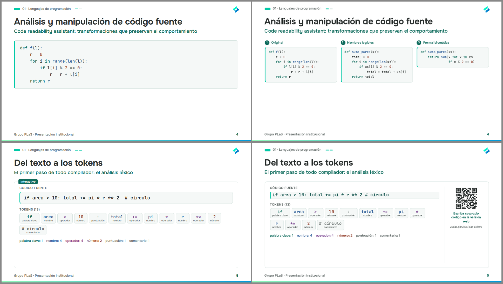

**Reglas:**

- Hasta unas 12 líneas de código por bloque. Si es más largo, divida o muestre solo lo esencial.
- El texto que acompaña al código va debajo del bloque, en tamaño pequeño.
- Toda animación necesita su versión impresa; el validador lo comprueba.

### 3.7 Interactiva — `interactive`

**Cuándo:** una herramienta o simulación que el público puede probar en la versión web (ver la imagen anterior, fila inferior).

```md
---
layout: interactive
---

# Del texto a los tokens

## El primer paso de todo compilador: el análisis léxico

<Interactive caption="Escriba su propio código en la versión web">
  <LexerDemo />
  <template #print>
    <LexerDemo readonly />
  </template>
</Interactive>
```

**Composición:** en la web, la herramienta en un recuadro con la etiqueta "Interactivo". En el PDF, la instantánea de `#print` con un código QR que lleva a esa diapositiva en la web.

**Reglas:**

- Un único `<Interactive>` por diapositiva, con `<template #print>` obligatorio.
- Las herramientas propias van en `components/` y deben aceptar un modo estático (por ejemplo, `readonly`).

---

## 4. Elementos de contenido

### 4.1 Énfasis y listas

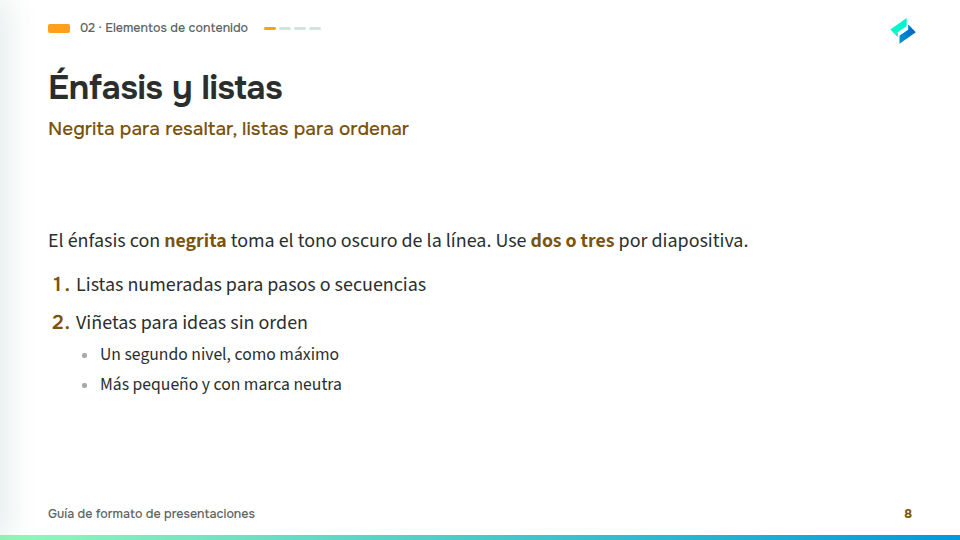

| Elemento | Markdown | Resultado | Regla |
|---|---|---|---|
| Énfasis | `**texto**` | Negrita en el tono oscuro de la línea | Dos o tres por diapositiva; nunca frases completas |
| Cursiva | `*texto*` | Cursiva | Para términos o títulos de obras |
| Viñetas | `- texto` | Marca cuadrada en el color base de la línea | Máximo 6 de primer nivel |
| Lista numerada | `1. texto` | Número en el tono oscuro de la línea | Para pasos o secuencias |
| Segundo nivel | Sangría de 3 espacios | Más pequeño, con marca neutra | Máximo 2 niveles |

### 4.2 Citas y código en línea

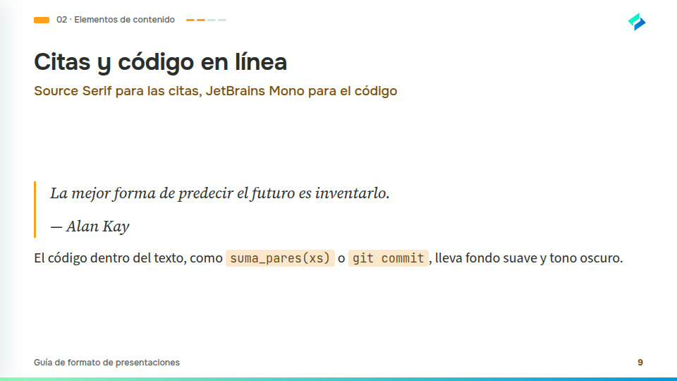

| Elemento | Markdown | Resultado |
|---|---|---|
| Cita | `> texto` y `> — Autor` | Source Serif en cursiva, con barra lateral en el color de la línea |
| Código en línea | `` `codigo` `` | JetBrains Mono con fondo suave y tono profundo |

### 4.3 Tablas

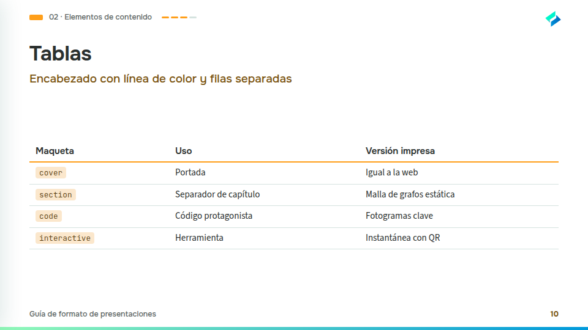

Encabezado en Onest con línea inferior en el color de la línea; filas separadas por líneas finas; cuerpo en 15 px. Máximo unas 6 filas y 4 columnas; si la tabla es más grande, divídala o muestre solo lo esencial.

### 4.4 Ecuaciones

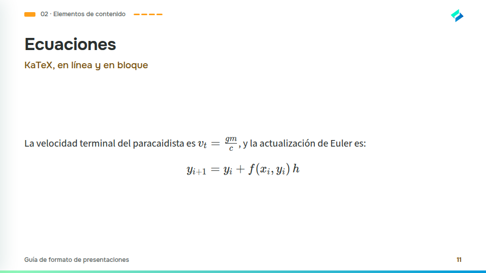

| Tipo | Markdown |
|---|---|
| En línea | `$v_t = \frac{gm}{c}$` |
| En bloque | `$$ … $$` en líneas propias |

Las fuentes de KaTeX quedan incrustadas en el PDF.

### 4.5 Tarjeta de proyecto — `<ProjectCard>`

Ver la imagen de la sección 3.5.

| Atributo | Contenido | Obligatorio |
|---|---|---|
| `title` | Nombre del proyecto | Sí |
| `kind` | Etiqueta superior (por defecto, "Proyecto") | No |
| `level` | Maestría, doctorado… | No |
| `people` | Equipo | No |
| `funding` | Financiación | No |
| Contenido | Una o dos frases de descripción | No |

### 4.6 Imágenes

- Propias o con licencia que permita su uso; indique la fuente si no son propias.
- Al menos 1600 px de ancho para ocupar media diapositiva.
- Sin memes ni imágenes de origen mezclado en presentaciones institucionales.
- Prefiera diagramas propios en SVG a capturas de pantalla.

---

## 5. Validación

```bash
npm run check    # reglas estáticas + renderizado de cada diapositiva en web y PDF
npm run export   # PDF en export/
```

| Regla | Límite | Tipo |
|---|---|---|
| Maqueta | Solo las de este documento | Error |
| Separador | `line` válido | Error |
| Título | 1 línea, máx. 50 caracteres | Error |
| Subtítulo | Máx. 90 caracteres | Aviso |
| Viñetas | Máx. 6 de primer nivel, máx. 2 niveles | Error |
| Texto | Máx. ~110 palabras | Aviso |
| Paridad | Cada `<WebOnly>` con su `<PrintOnly>`; cada animación y cada `<Interactive>` con su versión impresa | Error |
| Colores | Ninguno escrito a mano | Error |
| Alineación | Nunca justificado | Error |
| Desborde | Nada se sale de la diapositiva ni invade el pie, en la web ni en el PDF | Error |

Cada mensaje indica la diapositiva, la línea del archivo, la regla y la corrección.

---

## 6. Lo que no se debe hacer

- Escribir colores, tamaños de letra o márgenes a mano.
- Reducir la letra para que algo quepa: **divida la diapositiva**.
- Usar maquetas que no estén en este documento.
- Poner contenido solo en la web.
- Justificar el texto o resaltar frases completas.
- Entregar una presentación sin pasar `npm run check`.

---

## 7. Pendiente

Maquetas del catálogo (documento 03, §6) que aún no existen; por ahora, use `default`:

| Maqueta | Uso previsto |
|---|---|
| `closing` | Cierre con contacto y logos |
| `team` | Equipo o profesores con su línea y contacto |
| `two-cols` | Comparaciones en dos columnas iguales |
| `quote` | Cita a pantalla completa |
| `math` | Desarrollo de ecuaciones paso a paso |
| `diagram` | Diagrama o flujo con la paleta de las líneas |
| `cover-brand` | Portada de marca para cursos y presentaciones largas |
